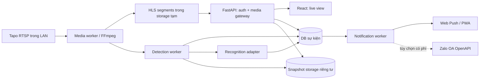

# Kiến trúc hệ thống

## Sơ đồ

## Các thành phần

| Thành phần | Trách nhiệm |
| --- | --- |
| React + TypeScript | Đăng nhập, danh sách camera, live player HLS, sự kiện, cài đặt; không giữ bí mật RTSP/Zalo |
| FastAPI | REST, auth/session, phân quyền, HLS gateway, dữ liệu cấu hình, audit |
| Media worker | Một ingest RTSP/camera, FFmpeg chuyển thành HLS; theo dõi heartbeat, restart có backoff, dọn segment cũ |
| Detection worker | Lấy frame có giới hạn FPS từ ingest, phát hiện người, gom frame thành event |
| Recognition adapter | Trích xuất đặc trưng và so khớp danh sách đã đồng ý; model/threshold có thể thay đổi |
| Notification worker | Rule, cooldown, idempotency, retry, Web Push adapter mặc định và Zalo adapter tùy chọn; lỗi gửi không chặn pipeline |
| SQLite ban đầu | Camera metadata, tài khoản, event, cấu hình, audit, notification attempt; nâng PostgreSQL nếu nhiều worker/ghi cao |
| Private storage | Snapshot, ảnh đăng ký và embedding; truy cập qua API có auth, có thời hạn lưu |

## Luồng live view

1. Admin cấu hình IP/port/path và camera account; backend kiểm tra và lưu secret ngoài bản ghi hiển thị. Chỉ cho phép endpoint RTSP trong dải mạng được cấu hình, chống truy cập địa chỉ tùy ý.
2. Worker mở RTSP trong LAN bằng FFmpeg, chuyển ra HLS. Khi codec nguồn đã phù hợp, ưu tiên remux; nếu không, transcode có kiểm soát CPU. Không khẳng định mọi camera tương thích codec sẵn.
3. Browser lấy manifest và segment qua FastAPI/reverse proxy có xác thực. Dùng cookie HttpOnly, SameSite và TLS khi truy cập qua mạng khác; player HLS.js ở browser cần thiết, native HLS khi hỗ trợ.
4. Ingest vẫn tồn tại khi có nhiều viewer; khi không ai xem có thể dừng theo chính sách, nhưng nếu detection đang bật thì tiếp tục.

**Chọn HLS cho V1:** hỗ trợ browser tốt và đơn giản để vận hành. Độ trễ thường tính bằng vài segment. Nếu yêu cầu dưới 1 giây sau này, đo trước rồi thiết kế nhánh WebRTC riêng.

## Luồng nhận diện và cảnh báo

1. Detection lấy frame ở tần suất cấu hình, phát hiện người, gom các frame gần nhau thành một episode/event.
2. Chỉ chạy nhận diện khuôn mặt khi thấy mặt đủ chất lượng. Không thấy mặt/ảnh mờ/không đủ tin cậy => `uncertain`; khớp đủ ngưỡng => `known`; không khớp nhưng đủ chất lượng => `unknown`.
3. Rule cảnh báo yêu cầu event `unknown` ổn định qua nhiều frame hoặc thời gian tối thiểu; áp dụng cooldown theo camera và thời gian.
4. Tạo outbox record cùng transaction với event/rule. Notification worker gửi qua adapter Web Push mặc định, ghi mã kết quả, retry lỗi tạm thời có backoff; lỗi vĩnh viễn chờ Admin xử lý. Zalo adapter chỉ chạy khi có quyền OpenAPI hợp lệ.
5. Gửi nội dung tối thiểu: camera, thời gian, đường dẫn đăng nhập xem sự kiện. Ảnh chỉ gửi nếu API và chính sách cho phép và Admin bật rõ ràng.

## Ranh giới và vận hành

- V1 có thể chạy API + media worker + detection worker dưới cùng bộ Docker Compose; vẫn tách process để lỗi FFmpeg/AI không làm sập API.
- SQLite chỉ dùng khi một node và quy mô nhỏ; bật WAL, migration và backup. Queue/outbox trong DB đủ cho V1; chuyển broker khi đo thấy cần.
- Secrets qua environment/secret mount; tuyệt đối không lưu RTSP URL có mật khẩu trong log.
- Health: API liveness, DB readiness, trạng thái từng camera và tuổi frame cuối. Timeout/restart có giới hạn, tránh vòng lặp ngốn CPU.
- Không cho browser gọi camera trực tiếp; không public storage và port RTSP. Truy cập ngoài nhà mặc định dùng VPN trên thiết bị người dùng và server; xem `DEPLOYMENT.md`.
- Web Push cần HTTPS/secure context và người dùng cấp quyền thông báo; cơ chế nhận push trên điện thoại phụ thuộc trình duyệt/hệ điều hành. Có màn hình lịch sử sự kiện và trạng thái gửi để không phụ thuộc riêng vào push.
